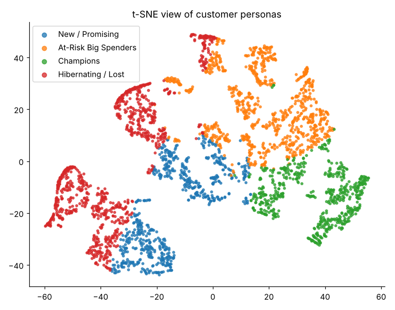

# E-Commerce Customer Segmentation (RFM, K-Means, DBSCAN, PCA, t-SNE)

**Author:** Utkarsh Singh

## Problem
An online retailer wants to personalise marketing instead of sending one campaign to everyone. Using **RFM (Recency, Frequency, Monetary)** features, this project clusters customers, visualises the segments and derives **actionable marketing personas**.

## Approach
1. Build the RFM table from transaction data.
2. Pre-process: `log1p` (to reduce skew) and `StandardScaler`.
3. **PCA** for dimensionality reduction and interpretation of loadings.
4. **K-Means** with elbow, silhouette and Davies-Bouldin to choose k.
5. **DBSCAN** with k-distance graph and a small grid search for `eps` / `min_samples`.
6. **t-SNE** to visualise the segments.
7. Profile each cluster and map it to a persona and a marketing action.

## Results (synthetic run, 3,000 customers)
| Persona | % customers | % revenue | Action |
|---|---|---|---|
| Champions | ~19 | ~64 | VIP programme, early access, referrals |
| At-Risk Big Spenders | ~30 | ~27 | Win-back outreach, high-value coupon |
| New / Promising | ~22 | ~4.5 | Welcome series, second-purchase incentive |
| Hibernating / Lost | ~29 | ~4.4 | Cheap automated reactivation |

K-Means: k = 4, silhouette about 0.35, Davies-Bouldin about 0.93. PCA: 2 components explain about 96% of variance. DBSCAN: eps 0.5, min_samples 10, under 1% noise.



## Data
* If `data/online_retail.csv` exists (the [UCI Online Retail dataset](https://archive.ics.uci.edu/dataset/352/online+retail), columns `InvoiceNo, CustomerID, InvoiceDate, Quantity, UnitPrice`), it is used.
* Otherwise the code **generates synthetic transactions with the same schema**, so everything runs out of the box. Numbers above come from the synthetic data and will differ on the real dataset.

## Project structure
```
.
├── src/rfm_segmentation.py              # full pipeline (run as a script)
├── notebooks/rfm_customer_segmentation.ipynb   # executed notebook with explanations
├── outputs/                             # figures, rfm_with_segments.csv, persona_summary.csv, summary.json
├── data/                                # place online_retail.csv here (optional)
└── requirements.txt
```

## Run
```bash
pip install -r requirements.txt
python src/rfm_segmentation.py          # regenerates outputs/
jupyter notebook notebooks/rfm_customer_segmentation.ipynb
```

## Limitations and future work
* RFM ignores product mix, returns and channel data; adding basket size or category features could sharpen the segments.
* Personas are rule-based labels on K-Means clusters and should be validated with a real campaign (A/B test).
* Other options to compare: Gaussian Mixture Models, hierarchical clustering, RFM quintile scoring.
