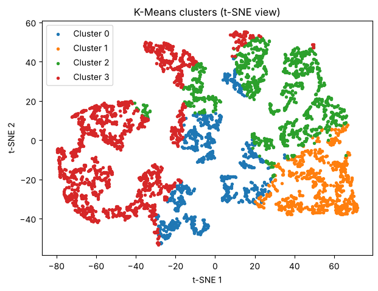
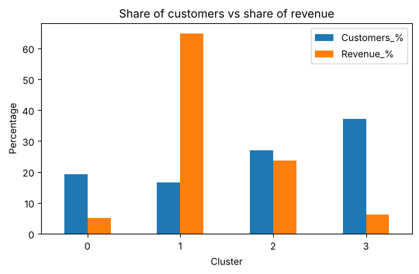

# E-Commerce Customer Segmentation using RFM

Customer segmentation of an online retailer using **RFM analysis**, **K-Means**, **DBSCAN**, **PCA** and **t-SNE**, ending with marketing personas for each segment.

**Author:** Utkarsh Singh

## Dataset
[Online Retail dataset](https://archive.ics.uci.edu/dataset/352/online+retail) from the UCI Machine Learning Repository (Daqing Chen, CC BY 4.0).
* Transactions of a UK-based online gift retailer from 01-12-2010 to 09-12-2011
* 541,909 rows and 8 columns (`InvoiceNo, StockCode, Description, Quantity, InvoiceDate, UnitPrice, CustomerID, Country`)
* After cleaning: 397,884 rows and **4,338 customers**
* File used: `data/online_retail.csv`

## Method
1. **Cleaning:** removed rows without `CustomerID`, cancelled/returned orders (negative quantity) and zero prices.
2. **RFM table:** Recency (days since last purchase), Frequency (number of orders), Monetary (total spend) for every customer.
3. **Log transform and scaling** to handle the skewed values.
4. **PCA** to 2 components (keeps about 94% of the variance).
5. **K-Means** with the elbow method and silhouette score, k = 4.
6. **DBSCAN** (`eps = 0.5`, `min_samples = 10`) for comparison and outlier detection.
7. **t-SNE** and PCA plots to visualise the clusters.
8. Profiling each cluster and defining marketing personas.

## Results
| Persona | Customers | Revenue | Avg recency (days) | Avg orders | Avg spend |
|---|---|---|---|---|---|
| Champions | 16.5% | 64.9% | 12 | 13.7 | 8,074 |
| Regular customers | 27.0% | 23.7% | 71 | 4.1 | 1,803 |
| New customers | 19.3% | 5.2% | 18 | 2.1 | 552 |
| Lost customers | 37.2% | 6.2% | 183 | 1.3 | 344 |

* A small group of Champions brings about two-thirds of the revenue.
* DBSCAN found 2 broad clusters and 79 outliers; K-Means gave more useful segments for marketing.





## Project structure
```
.
├── customer_segmentation.ipynb   # full analysis with explanations
├── data/online_retail.csv        # dataset
├── images/                       # saved plots
├── requirements.txt
└── README.md
```

## How to run
```bash
pip install -r requirements.txt
jupyter notebook customer_segmentation.ipynb
```

## Limitations
* Only purchase history is used (no product category, location or demographics).
* The personas should be validated with real marketing campaigns.
